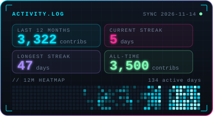
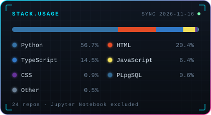

<div align="center">



<a href="https://linkedin.com/in/kevin-murgana"></a>
<a href="https://kaggle.com/kevinmurgana"></a>
<a href="mailto:murgana.kevin@gmail.com"></a>
<a href="https://restoradar.app"></a>
<!-- Más enlaces (descomentar y ajustar):
<a href="https://instagram.com/kevinmurgana"></a>
-->

</div>

### `// WHOAMI`

```text
┌────────────────────────────────────────────────────────────┐
│ kevin@argentina:~$ whoami                                  │
│                                                            │
│  role      Sr. Data Scientist · 4+ years                   │
│  focus     Machine Learning · NLP · GenAI                  │
│  genai     RAG pipelines · LangChain · OpenAI API          │
│  building  RestoRadar -> restoradar.app                    │
│  stack     Python · SQL · PyTorch · TensorFlow             │
│  reach     murgana.kevin@gmail.com                         │
└────────────────────────────────────────────────────────────┘
```

### `// STACK`

<div align="center">

**`ML · DL`** &nbsp;


**`GenAI`** &nbsp;


**`DATA`** &nbsp;


**`ALSO`** &nbsp;


</div>

### `// TELEMETRY`

<div align="center">




<sub>Cards regenerated daily by a GitHub Action from the GitHub API.</sub>

</div>

<div align="center">



<a href="https://github.com/Kmurgana"></a>

</div>
